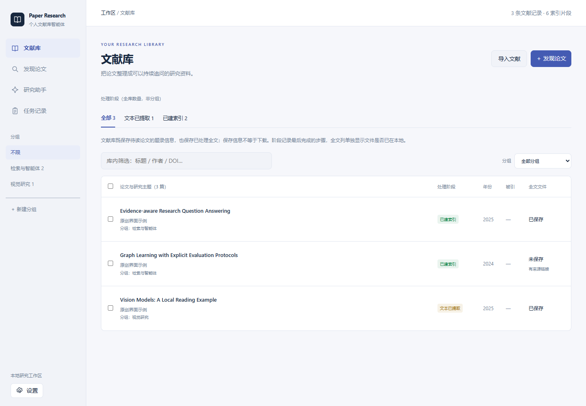
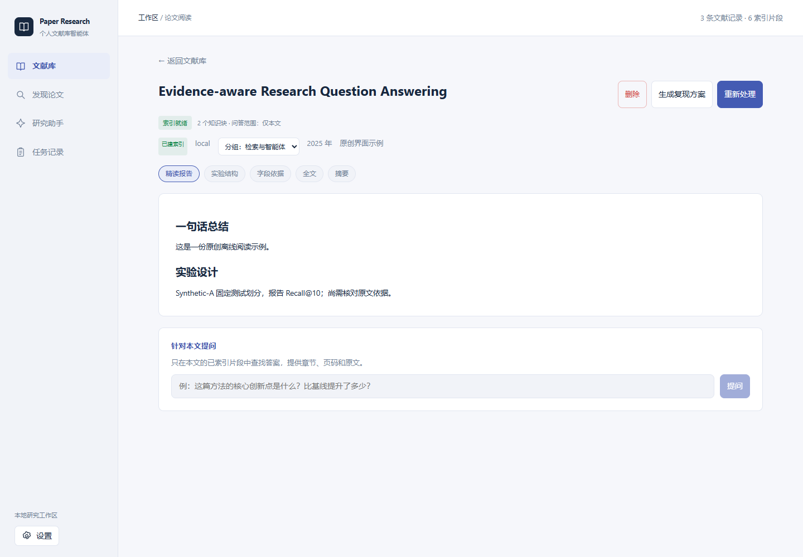
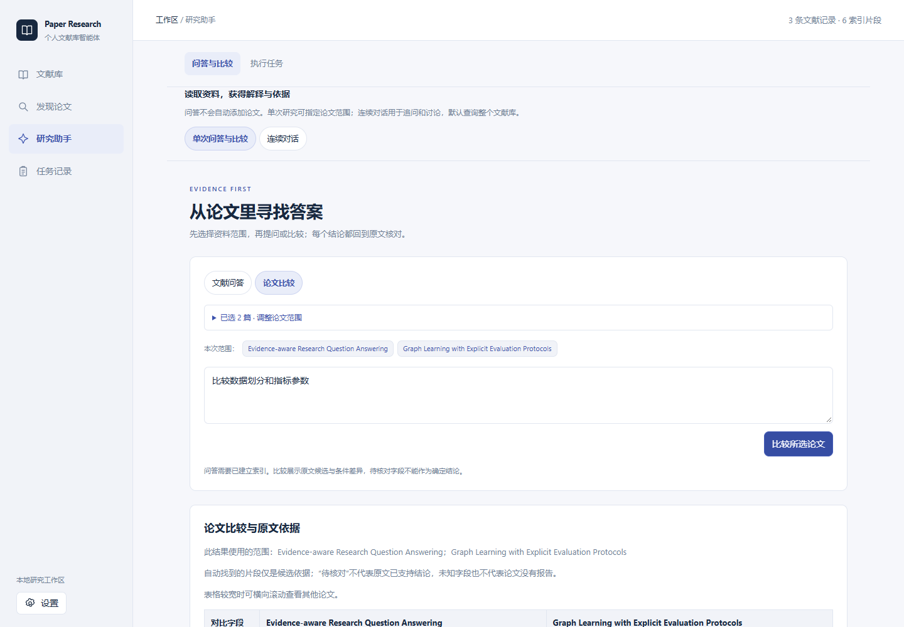
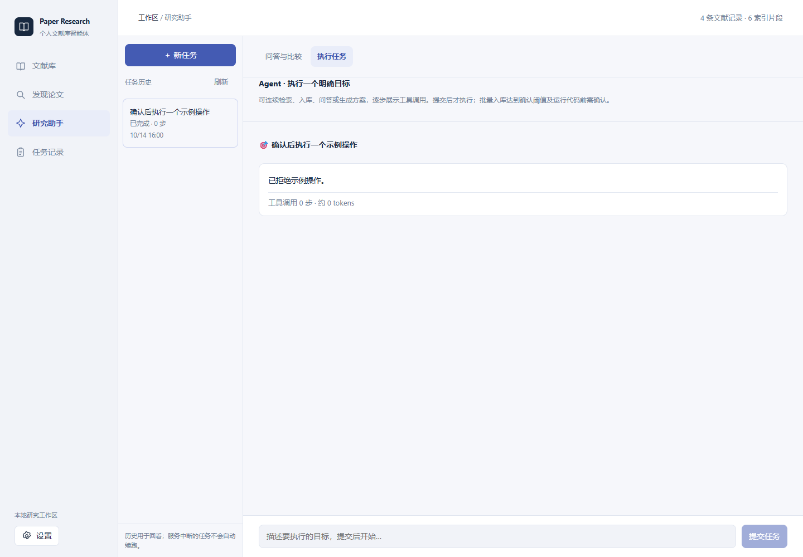
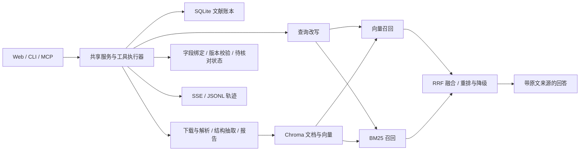

# Paper Research Agent · 个人文献库智能体

从论文发现、筛选入库到可溯源问答与跨论文比较的研究助手，提供 Web、CLI 和 MCP 三种入口。

[](https://github.com/yycf1/paper-research-agent/actions/workflows/ci.yml)


**核心场景：** 收集同一主题的论文，处理全文，追问研究方法与实验设置，再逐字段检查不同论文的研究目标、数据集和指标依据。

[快速开始](#快速开始) · [离线体验](#无需密钥的离线体验) · [架构](docs/architecture.md) · [演示](docs/demo.md) · [验证记录](docs/validation.md)

## 项目展示



*文献库与在线发现分开，支持分组、筛选、勾选问答与比较；截图使用原创离线界面示例。*



*阅读页保留索引就绪状态、报告、字段依据与本文问答。截图是原创合成响应，不代表真实模型效果。*



*勾选两篇论文即可查看字段候选与实验条件差异；“待核对”保留原意，不以裸值排名。*



*问答与多步执行分开；历史常驻左侧，查看历史不会中止正在运行的任务。截图为原创离线示例。*

## 已实现的能力

| 能力 | 当前实现 |
| --- | --- |
| 论文发现与管理 | OpenAlex / Europe PMC / arXiv 检索，候选预览后选收入库，跨源去重、分组、状态记录及本地 PDF/DOCX 导入 |
| 文献处理 | 下载 → 解析 → 实验结构提取 → 精读报告 → 向量索引；后置附录、分段覆盖/遗漏记录、内容与配置版本检查及失败回滚 |
| 可溯源问答 | 显式全库/论文子集，向量与 BM25 共用范围，经 RRF 融合和可选重排；区分失败状态，在线检查引用结构并至多修复一次 |
| 跨论文比较 | 原始/规范化字段及版本化引用，显式展示指标参数、划分、定义、单位与评估协议的差异/缺项；不自动判断公平可比性 |
| Agent 工具编排 | Function Calling 循环，工具结果回填、错误分类、重复调用限制、步数与用量限制；宿主指定论文范围，读写/执行前校验，人工确认 |
| 任务可观察性 | SSE 步骤流、断流轮询回退、JSONL 轨迹、历史任务回读及上下文窗口压缩 |
| 证据诊断 | 记录向量、BM25、融合、重排和最终候选，定位证据在哪一阶段遗漏；离线报告和人工复核与具体产物绑定 |
| MCP 与复现扩展 | CLI/Web/MCP 复用同一工具执行器；提供复现方案、代码工作区、确认后运行与输出记录 |

**引用定位正确不等于原文支持结论。** 自动字段匹配保留 `unverified`；当前不自动判断实验可比性，不据未经核对的数值排名。复现扩展执行本机 Python 子进程，尚不具备容器隔离，不能用于运行不可信代码。

## 快速开始

要求 Python 3.11+、Git 和 uv。仓库包含前端构建产物，正常启动不要求 Node.js；修改前端时需 Node.js 20.19+ 或 22.12+。

```bash
git clone https://github.com/yycf1/paper-research-agent.git
cd paper-research-agent
uv sync --locked
```

复制 `.env.example` 为 `.env` 并填写自己的密钥：Windows PowerShell 使用 `Copy-Item .env.example .env`；macOS/Linux 使用 `cp .env.example .env`。

```dotenv
LLM_API_KEY=填写自己的密钥
```

默认 `config.yaml` 配置为 DeepSeek-V3.2 对话模型、BGE-M3 嵌入模型与 BGE Reranker，均使用配置指定的兼容端点及 `LLM_API_KEY`。可分别修改端点、模型和密钥变量；Web 设置只覆盖对话模型。调用模型可能产生费用，启动服务本身不调用模型。

```bash
uv run pa serve --host 127.0.0.1 --port 8000
```

打开 <http://127.0.0.1:8000>；API 文档在 <http://127.0.0.1:8000/docs>。新克隆的文献库为空，先上传自己的 PDF/DOCX 或检索后选择入库，再点击“一键处理”。本地数据默认保存在被 Git 忽略的 `data/`。

Windows 也可运行 `powershell -ExecutionPolicy Bypass -File .\启动演示.ps1`。安装与配置详见 [使用指南](docs/usage.md)。

## 无需密钥的离线体验

仓库附带原创合成文本，展示 BM25 候选、版本校验和证据报告。无需下载论文、创建向量库或调用模型：

```bash
uv run pa eval-evidence --dataset examples/offline-evidence/cases.json --snapshot examples/offline-evidence/corpus.json --mode bm25 --k 2 --output data/evidence-eval/offline-demo.json
```

查看生成的 JSON 和同名 Markdown。合成样例用于理解流程，不是论文检索效果基准，也没有生成或验证模型答案。

## 架构与技术



- **后端：** Python、FastAPI、SQLite、Chroma、PyMuPDF、python-docx。
- **智能体：** 自定义 Function Calling 循环；LangGraph 用于处理流水线；MCP 适配复用工具注册表。阶段续跑依据账本与已有产物，未接入 LangGraph checkpoint 恢复。
- **前端：** React 19、TypeScript、Vite、SSE。
- **检索：** BGE-M3 + BM25 + RRF + BGE Reranker；可记录各阶段候选与降级信息。

代码入口和数据流见 [架构说明](docs/architecture.md)。Python 包名 `paper_agent`、分发名 `paper-agent` 和命令 `pa` 保持兼容。

## 验证与已知边界

2026-10-14 本地完整回归 **366 项通过**，前端构建通过；电脑端 1440×1000、1280×900 共 **36 项离线交互检查通过**。另完成真实临时 SQLite/Chroma 的五项 API 与预打包资源联调，没有真实模型调用。详细条件见 [验证记录](docs/validation.md)，GitHub 运行结果以顶部 CI 链接为准。

历史开发集包含 26 条问题，其中 25 条有章节标签。按论文限定范围的组件对照中，MRR 从 0.679 到 0.733，Hit@8 从 100% 降至 92%；不能将其解释为整体问答准确率提升。三篇论文字段快照中，预算内 15 项事实全部仍待语义核对。

主要边界：

- 长文抽取与报告每段最多 36,000 字符、最多四段；超预算优先开头、末尾及实验/结果/附录窗口，并记录遗漏范围。PDF 默认最多解析 60 页；扫描件 OCR 与复杂表格重建尚未覆盖。详见 [文献覆盖说明](docs/document-coverage.md)。
- BM25 每次在内存读取并计分个人库文档，未进行大规模索引性能验证。
- 片段归属与逐字摘录可校验，语义支持仍需复核；单位、数据划分与任务定义不足时不能直接比较指标。
- 模型服务和论文源可能超时、限流或不可用；降级提示不代表结果质量得到保证。
- 本地工作区与执行超时不等于安全沙箱；当前服务面向本机使用，未提供公网部署所需的用户认证与权限体系。

## 开发与文档

```bash
uv sync --locked --dev
uv run pytest -q
uv run pa --help
```

```bash
cd web
npm ci
npm run build
npm run lint
```

| 文档 | 内容 |
| --- | --- |
| [使用指南](docs/usage.md) | 安装、配置、CLI/Web/MCP 与故障处理 |
| [五分钟演示](docs/demo.md) | 正常流程、证据展开、比较与失败展示 |
| [架构说明](docs/architecture.md) | 模块职责、工具执行、检索与证据链 |
| [验证记录](docs/validation.md) | 测试、历史检索对照、证据快照和限制 |
| [证据级评测](docs/证据级评测与学习说明.md) | 失败分类、标签和离线复核 |
| [字段证据绑定](docs/字段证据绑定与学习说明.md) | 引用与语义支持的区别、代码阅读路径 |
| [开发历史](docs/devlog/README.md) | 各阶段实现与历史实验记录 |

反馈问题时请附运行命令、环境、预期行为和脱敏错误信息，参见 [贡献说明](CONTRIBUTING.md)。
