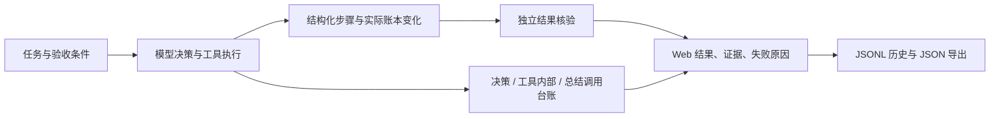

# Agent 结果验收、调用观测与演示回放

任务执行结束后，系统依据预先选择的验收条件检查实际状态和证据。模型回复“已完成”不会直接提高完成率。



## Web 使用

打开“研究助手”，在输入框选择“执行操作”，展开“操作验收选项”后提交：至少保存一篇新题录、带来源与有效引用的库内回答、只检索不更改文献记录，或仅记录过程。默认仅记录过程，不自动从自然语言猜测完整业务目标。

“任务记录”与研究助手共用结果面板：先展示验收状态、步骤数、模型服务调用数、已报告对话用量和耗时，再展开工具时间线、原文证据和调用明细。调用参数收进详情；记录可导出 JSON。选择历史记录不会重放执行。普通库内问答也可查看调用台账。

| 状态 | 含义 |
| --- | --- |
| 目标已核验 | 所选验收条件均通过、执行正常结束、工具步骤没有失败或降级 |
| 目标未达成 | 条件未通过，或执行发生错误、触及限制、没有有效最终回复 |
| 部分完成 | 条件通过但存在失败或降级步骤，需要回查 |
| 待核验 | 没有明确验收条件，或无法取得必要状态；不能当作成功样本 |

状态仅覆盖所选条件。例如，“至少一篇”不会证明自然语言中额外要求的两篇、年份或研究主题全部满足。可通过 API 指定更严格的数量与 ID 条件；语义质量仍需另外评估。

## 验收条件与评测口径

提交 `/api/agent/tasks` 时可传 `acceptance`，最多 12 项。条件在执行前校验，执行后独立判断：

```json
{
  "task": "查找两篇相关论文并保存题录",
  "acceptance": [
    {"kind": "library_add", "min_added": 2},
    {"kind": "tool_success", "tools": ["search_papers", "add_papers"]}
  ]
}
```

| 条件 | 实际检查 |
| --- | --- |
| `library_add` | SQLite 新增 ID 与成功入库步骤确认的 ID 相交，达到 `min_added`；可用 `source_ids` 指定新增 ID。已有题录的去重合并不算新增 |
| `no_library_mutation` | 前后题录、状态、全文路径等文献行的指纹相同 |
| `tool_success` | 所列工具各至少一次正常返回；仅检查操作状态，不证明业务语义 |
| `evidence_answer` | 问答工具生成有效答复、有非空来源片段、来源论文仍在账本，重新检查回答引用编号；不直接信任附带的“通过”文字 |

引用检查针对问答工具返回的回答和片段，不自动证明最终 Agent 总结的全部事实或引用语义正确。只读检查仅覆盖文献行，不是整个文件系统的审计；并发写入可能影响前后快照，因此评测必须隔离资料。

`pa eval-agent` 的 `execution_finished` 单独表示执行结束；`completed` 必须通过显式条件及工具约束。必调工具只有 fatal 记录不能算合规。关键词命中单独记录，不当作业务完成或答案正确的凭据。旧任务集未设置条件的项目显示待核验；“已核验完成占全部任务”以全部案例为分母，并同时报告待核验数。

`pa eval-agent --trace` 保存逐次 JSONL 调用轨迹及包含验收、用量信息的结果 JSON。评测会执行任务中的实际写入，应使用隔离配置，避免在个人库运行入库或代码用例。

## 调用台账与边界

任务上下文由 ContextVar 隔离。LLM、Embedding、Reranker 适配器记录阶段、模型、耗时、结果、服务返回用量和错误类型，不写提示词、API Key 或配置中的密钥。QA 改写、回答、空回复重试、证据复核、引用修复分别记录；Agent 收尾总结也计量。嵌套工具共享父任务台账，注入函数兜底观测不会重复计算真实适配器调用。

SDK 隐式重试关闭，连接异常及部分临时 HTTP 状态最多三次显式尝试，LLM 429 使用既有四次有界退避；余额不足不重试。每次实际尝试分别记账。重排序接口没有返回 usage 时标为未知，不能当作免费调用。未配置价格，费用保持未知。

对话、向量化、重排序分开汇总。已报告值不包含缺失用量，覆盖度和未知调用数可见。`agent.token_budget` 按已报告对话 token 在下一轮决策前检查，工具内部调用和最后总结可能超出，是软预算，不是费用硬上限。

JSONL 每个调用完成后写入，进程中断仍可回读已完成的调用与步骤；尚未返回的服务请求没有可靠用量，轨迹不是完整账单。历史不会自动续跑。

## 可复查演示

“任务记录 → 研究任务演示回放”提供两条真实模型记录，回放不发送新任务：

| 录制案例 | 实际执行与验收 | 模型服务调用 |
| --- | --- | --- |
| 成功 | 查看所选论文状态 → 混合检索与证据问答 → 最终回答；结果验收通过 | 6 次：4 次对话、1 次向量化、1 次重排序 |
| 失败 | 查看未索引论文状态 → 尝试问答 → 如实解释缺少索引；证据回答条件未通过，文献未变更 | 4 次：3 次对话、1 次向量化 |

模型为 DeepSeek-V3.2、BGE-M3、BGE Reranker v2 M3。成功报告 7,277 对话 tokens、20 向量 tokens；失败报告 6,151 对话 tokens、11 向量 tokens。成功案例的重排 usage 未返回，保留未知。资料准备另有一次向量化、253 tokens，放在 `setup_telemetry`，没有计入任务用量。合计 11 次服务请求，不估算费用。

资料为原创合成内容，通过真实 PDF 解析、分块、向量索引和模型服务运行。0.72 是示例数值，不是论文复现或真实基准成绩。失败分支是主动准备的未索引资料，不代表线上随机故障比例。两条演示不能推算通用任务成功率。

见 [演示 JSON](../eval/agent_demos.json)，原始轨迹路径与 SHA256 在各条记录内。重新录制会消耗服务额度：

```powershell
$env:PYTHONPATH = Join-Path (Get-Location) 'src'
python scripts/record-agent-demos.py --live --config-root '配置所在的项目目录'
```

脚本在当前项目 `data/agent-demos/独立运行目录` 创建原创资料，不读取个人文献库。每次尝试保留原始结果；只有成功/失败两条预期分支均被实际执行后才更新发布的回放记录。模型输出不保证跨次相同。

代码阅读顺序：`agent/loop.py` → `agent/verification.py` → `observability.py` → `server/agent_jobs.py` → `AgentRunReview.tsx` / `CallLedgerView.tsx`。重点是任务状态与目标状态分离、实际状态变化、嵌套调用归属、未知用量和失败反馈。
