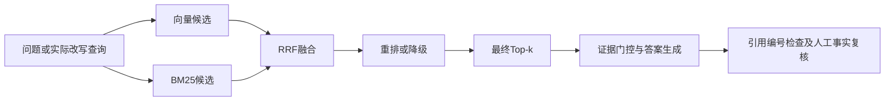

# 证据级评测：先看问题发生在哪一段

日期：2026-10-13。本轮完善的是诊断基础设施与离线基线，没有宣称模型效果提升。旧 `pa eval` 及其章节级结果继续保留。

## 本轮新增能力

- `pa evidence-snapshot`：导出当前索引文本及版本摘要，不调用模型。快照包含文献内容，默认放在已忽略的 data 目录；已有文件需要显式 `--overwrite` 才能替换。
- `pa eval-evidence`：逐题记录两路召回、融合、重排、最终候选和降级信息。默认仅运行 BM25，不调用模型；生成 JSON 和中文 Markdown 报告。
- `pa review-evidence`：向已保存报告附加人工复核，不重新检索、不重新生成答案。复核绑定答案、上下文、查询、标签与语料摘要，内容变化时不能沿用旧结论。
- 问答链的可选 trace：记录原问题、实际检索查询、多轮改写状态、真正用于回答的片段，以及聊天调用的可获得 usage。常规调用不必启用。



离线 BM25 路径只经过 BM25 与最终 Top-k；不会把未运行的向量和重排阶段记成成功，也不生成答案。

## 为什么要改

旧评测用章节名子串判断命中，无法充分区分“章节命中但具体事实缺失”和“正确证据被截掉”。本轮标签指向论文 ID、块 ID、文本摘要和摘录；多个片段可以作为同一证据组的备选，跨论文任务可以要求多组证据。

语料版本变化或引用片段失效时排除评分，不能把标签失效记为检索失败。引用 `[1]` 的编号存在，只能证明指向了本次上下文的一段文字；语义上是否支持结论仍需复核。

## 公开可复现的离线示例

历史私人语料的题目与摘录已移出当前版本。当前 `eval/evidence_cases.json` 与 `examples/offline-evidence/cases.json` 使用同一组原创三题夹具，不能当作历史基准。

```bash
uv run pa eval-evidence --dataset examples/offline-evidence/cases.json --snapshot examples/offline-evidence/corpus.json --mode bm25 --k 2 --output data/evidence-eval/offline-demo.json
```

要评估自己的语料，使用 `pa evidence-snapshot` 导出快照并为对应版本制作标签，产物放在 `data/`。标签失效时重新核对摘录，不能仅替换哈希。

## 线上与人工复核入口

向量、混合、混合重排分别使用 `--mode vector`、`--mode hybrid`、`--mode hybrid-rerank`，需要显式 `--live`。`--with-answers` 才会生成答案；`--limit` 可限制本次病例数。线上模式不接受仅含文本的快照作为向量索引。

线上调用需要可用端点和预算，本轮没有执行。配置中的模型名称会记录为“配置值”，不会冒充索引构建时已经核实的模型版本。聊天 usage 不包含无法获取的 Embedding/Reranker 费用。

复核文件顶层为 `reviews` 数组，每项包含本次报告的 case_id、artifact_sha256、reviewer，并至少给一个实际复核过的布尔判断：answer_correct、citation_supported、refusal_correct。未知维度留 null；字符串 "false" 不作为布尔值。

对保存的真实答案复核后执行：

```powershell
& '.\.venv\Scripts\python.exe' -m paper_agent.cli review-evidence --report data/evidence-eval/live.json --reviews data/evidence-eval/reviews.json --output data/evidence-eval/reviewed.json
```

以上文件名是入口示例，当前未创建虚构的 live 答案或人工评价。不能给本轮未生成的答案补“正确”分数。

## 根据本轮改动学习

1. 先运行原创示例，沿报告 sparse 和 final 数组观察同一块的位置变化。
2. 调小 k，观察标注片段在候选内但未进入最终 Top-k 的情况。理解候选深度和最终上下文大小的区别；本轮未运行重排，不能把原因归为重排模型错误。
3. 改变查询措辞，检查标注片段未进候选的情况。结合原文检查其他返回片段是否也支持答案，再决定补标签还是改检索，不先假设算法一定失败。
4. 阅读[检索与问答链](../src/paper_agent/rag/qa.py)，观察可选 trace 在哪些阶段采集信息。
5. 阅读[诊断逻辑](../src/paper_agent/rag/diagnostics.py)和[回归测试](../tests/test_evidence_diagnostics.py)，看失效标签、过期复核、引用越界和离线调用边界如何被验证。

这份路线用于沿真实产物理解实现，不需要先回答概念题或重写完整模块。

## 尚需推进

扩充经人工和原始 PDF 核对的证据备选，形成更独立的题目；在明确预算后运行同语料的线上组件对照与实际多轮回答，再人工复核事实、引用和拒答。

研究目标、数据集、指标的字段绑定后续已完成基础实现，见[字段证据绑定说明](字段证据绑定与学习说明.md)。当前后续工作是长文覆盖与缺失字段补检索，不把检索指标代替字段正确率。

## 本轮验证

- 最终完整回归：261 passed / 118.28 秒；包含新增 16 条诊断行为用例。
- 新增和相关检索/问答/CLI 定向回归：50 passed / 10.27 秒。
- 改动 Python 文件通过隔离配置下的 Ruff E4/E7/E9/F/I 检查；已有库没有强制引入新 lint 配置。
- 保留一个既有 Starlette/anyio 弃用提示。本轮没有重跑收费模型、重建索引或改写既有问答数据。
- 已实际生成并核对离线 JSON/Markdown 报告，确认快照位于忽略目录，未复核答案没有事实正确率。
